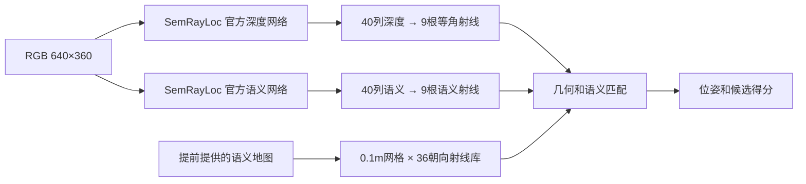
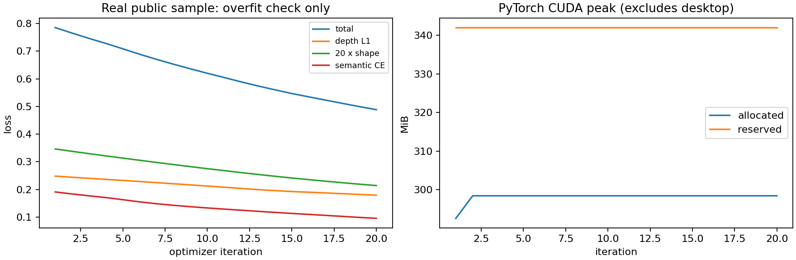
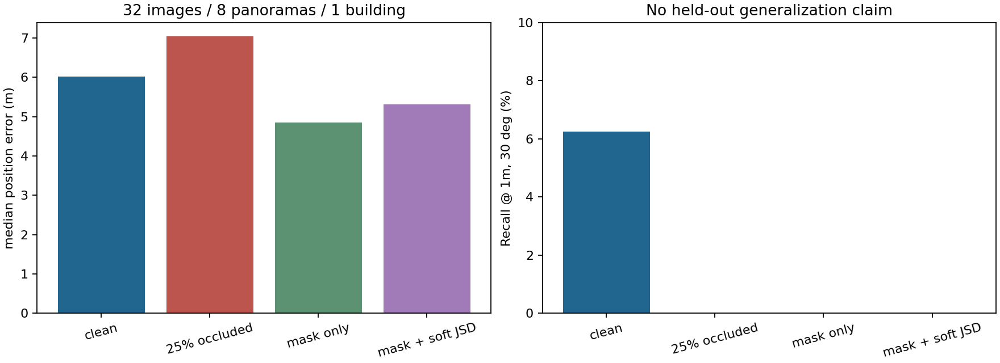

# FYP — Known-Map Geometric-Semantic Localization

本科 FYP：**Exploring Localization Techniques for Indoor Robotics**。

目标：在提前提供的固定建筑语义地图中，由 RGB 图像预测建筑深度与语义射线，匹配地图并输出机器人平面位姿 `(x, y, theta)`。

**目前是可运行的研究原型，尚未完成论文标准 Baseline 复现。预训练 coarse 定位仍然较差，不能作为可靠机器人定位系统。** 本仓库明确区分官方实现、自主集成与工程检查，不把论文数字当作复现结果。

## 最新工程审计（2026-10-25）

完整 coarse-to-fine 已接入，32图 A/B/C/D×Depth/Semantic/Combined 已实跑，16项测试通过。**定位问题仍未解决，P1独立建筑验收未通过，本轮没有新训练。** 官方配置双预测 fine Recall@1m,30°=12.5%，集成配置=6.25%；仅一栋公开住宅，不能作为泛化成绩。

- [本轮严谨中文报告](REPORT_AUDIT_zh.md)：诊断表、证据/假设、失败与未完成项。
- [运行命令与接口](docs/AUDIT_V2.md)：新在线入口 `src/localize.py`，离线诊断 `src/audit.py`。
- [逐图图册（本机生成）](results/audit_v2/gallery.html)、[完整指标](results/audit_v2/summary.json)、[逐图CSV](results/audit_v2/per_image_metrics.csv)、[真实运行及权重哈希](results/audit_v2/run_manifest.json)。本机服务 [本机图册](http://127.0.0.1:18766/gallery.html)。
- 配置明确分为 `configs/official_reproduction`、`configs/integration`、`configs/experimental`；[行为补丁说明](patches/README.md)。原始匹配分数不作为成功概率，正式训练已门控。

以下为 **v1历史工程记录**，保留原始数字；旧 `infer.py`/`evaluate.py`/`matching.py` 不代表本轮完整Baseline。旧mask/JSD只属工程实验，不作为研究改进证据。

## 我具体做了什么



| 文件 | 用途 |
|---|---|
| `src/common.py` | 导入官方网络，严格加载作者预训练权重 |
| `src/prepare_sample.py` | 复用官方几何处理，准备 ZInD 官方公开住宅示例 |
| `src/matching.py` | 官方 coarse 匹配与实验性置信度/JSD扩展 |
| `src/infer.py` | RGB → 射线 → 地图匹配 → 位姿、候选得分及可视化 |
| `src/evaluate.py` | 位置/角度误差、Recall、计时和遮挡消融 |
| `src/train.py` | 历史冻结主干smoke；正式训练现已门控 |
| `src/person_mask.py` | 可选 torchvision LR-ASPP 预训练人物分割接口 |
| `src/check_contracts.py` | 真实地图射线与官方函数的一致性检查、全遮挡拒绝定位 |
| `src/validate_manifest.py` | 检查样本字段、尺度与建筑泄漏 |
| `src/dashboard.py` | 只监听 localhost 的训练记录页 |
| `official_fixes.patch` | 官方代码的兼容性及明确错误修复，未重写网络 |

## 实际测到的结果

硬件：GTX1660 SUPER 6GB，16GB RAM；Python3.10、PyTorch2.5.1+cu121。数据：**一栋官方公开住宅，8个全景位置×4个方向，共32图**。预训练是否见过该住宅未知，不能据此评估泛化。

| 条件 | 位置误差中位数 | Recall@1m,30° |
|---|---:|---:|
| 官方权重 + coarse，无遮挡 | 6.02m | 6.25% |
| 中央25%灰色遮挡 | 7.04m | 0% |
| 遮挡 + 已知mask过滤 | 4.84m | 0% |
| 遮挡 + mask + soft JSD | 5.31m | 0% |

这不是完整论文评价：没有 refinement、room prior 或独立建筑测试集；语义采用确定性 argmax。mask 来自已知矩形，不能当成人物检测成绩。

冻结主干完成20次有效更新：Loss **0.7855 → 0.4885**，PyTorch峰值 allocated **298MiB** / reserved **342MiB**，检查点严格重载成功。训练图自身的定位误差降至0.112m、0.246°，**只说明能够过拟合，不是验证准确率**。





详细信息：[中文实测报告](REPORT_zh.md) · [研究笔记与官方代码问题](RESEARCH_NOTES_zh.md) · [版本/权重哈希](provenance.json) · [逐图评价](results/evaluation/per_image.csv) · [训练日志](logs/train.log)。日志中的 `${FYP_ROOT}` 是脱敏后的运行目录占位符。

## 在本机运行

本次实验文件实际保存在 `/data/fyp-semrayloc`，原 ROS2/Gazebo 环境没有修改。

```bash
export FYP_ROOT=/data/fyp-semrayloc
export FYP_PY="$FYP_ROOT/envs/semrayloc/bin/python"
export MPLCONFIGDIR="$FYP_ROOT/cache/matplotlib"

# 当前实验机器已经准备好环境、源码和权重，无需重复下载。
"$FYP_PY" src/prepare_sample.py
"$FYP_PY" src/validate_manifest.py "$FYP_ROOT/data/zind_public_sample/manifest.json"
"$FYP_PY" src/check_contracts.py
"$FYP_PY" src/infer.py --sample "$FYP_ROOT/data/zind_public_sample/samples/000_000" --out results/local_query
"$FYP_PY" src/evaluate.py --manifest "$FYP_ROOT/data/zind_public_sample/manifest.json" --out results/local_evaluation --limit 32
"$FYP_PY" src/train.py --manifest "$FYP_ROOT/data/zind_public_sample/manifest.json" --out "$FYP_ROOT/runs/smoke" --steps 20 --smoke
"$FYP_PY" src/dashboard.py --port 18765
```

记录页：`http://127.0.0.1:18765/`，仅在运行该服务的机器有效。推理时设置 `FYP_FINETUNED="$FYP_ROOT/runs/smoke/heads_finetuned.pt"` 可加载微调检查点；不要将其当作官方 Baseline。

### 在其他机器准备

```bash
export FYP_ROOT=/your/storage/fyp-semrayloc
python3 bootstrap.py  # clone固定版本并应用补丁；不会下载授权数据
python3.10 -m venv "$FYP_ROOT/envs/semrayloc"
export FYP_PY="$FYP_ROOT/envs/semrayloc/bin/python"
"$FYP_PY" -m pip install -r requirements.lock.txt
"$FYP_PY" fetch_weights.py  # 仅作者公开的两个ZInD权重，验证SHA256
```

`bootstrap.py` 和 `fetch_weights.py` 是上传仓库时新增的重建辅助程序，已做语法检查，尚未在另一台空白机器完成端到端重建。上述锁定依赖为本次Linux x86_64/Python3.10/CUDA12.1环境；不要直接覆盖系统或ROS Python。

## 数据契约

每个样本目录包含 `rgb.png`（640×360，80°水平FOV，已重力对齐）和 `sample.json`：

- `map`：固定语义地图PNG，0.01m/px；RGB黑墙、蓝窗、红门。
- `free_mask`：室内候选位置的NumPy mask，地图不受动态人物影响。
- `map_m_per_pixel`：当前必须为0.01；其他尺度须先重采样。
- `pose`：GT `[x,y,theta]`，米/弧度；x向右、图像y向下，正角在图像上逆时针。
- `depth_axial_m` / `semantic`：40个建筑结构轴向深度和40个类别（0墙/1窗/2门/3未知）。深度监督由固定地图与GT相机位姿生成，不能拿家具表面RGB-D深度直接替代。
- `building_id`：训练分区必须按建筑互斥。

实际机器人查询可省略GT pose及深度/语义标签，误差输出为null；须提供图像、地图、free mask和正确的尺度/内参。正式训练当前被明确拒绝，必须先完成独立建筑Baseline与完整验证/最佳checkpoint协议。历史单图smoke不满足正式训练要求。

## 复用与边界

- 主基线：[SemRayLoc官方实现](https://github.com/TAU-VAILab/SemRayLoc)，固定版本`072b7a3d6056c44ad95d08b269bdd296fc3eadab`。网络在运行时从该仓库导入；没有把官方网络重写成自研模型。
- 数据来源：[ZInD官方仓库公开sample_tour](https://github.com/zillow/zind/tree/main/sample_tour)。正式研究首选[Structured3D](https://structured3d-dataset.org/)，授权尚未取得。
- [CVPR2026论文](https://openaccess.thecvf.com/content/CVPR2026/papers/Ye_Fusion_of_Depth_and_Semantics_for_Probabilistic_Floorplan_Localization_CVPR_2026_paper.pdf)提供下一阶段思路。本次未找到可核验官方代码；`weighted_jsd`是实验扩展，不是该论文官方实现。
- [F3Loc](https://github.com/felix-ch/f3loc)与[UnLoc](https://github.com/matthias-wueest/UnLoc)已审计，用于后续连续定位；没有声称全部训练或运行。

本仓库不上传原始数据、作者权重、微调大权重或本机环境。权重和数据各自遵循其来源条款，公开源码不等同于自动取得数据授权。SemRayLoc所检出commit未含独立LICENSE文件，因此没有给第三方代码或权重擅自重新授权。

## 接下来做什么

1. 取得Structured3D小规模建筑互斥数据，核对尺度、朝向及官方ZInD径向/轴向深度疑点。
2. 先复现完整官方Baseline，再评价自己的改进；当前低精度原因尚未查清。
3. 在真实行人遮挡或Habitat场景验证人物mask与置信度，不能用灰矩形代替完整动态测试。
4. 最后封装ROS2节点、接入odom，公平比较histogram/particle filter与传统定位方法。
