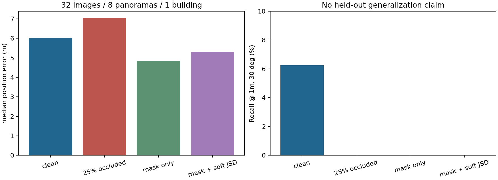
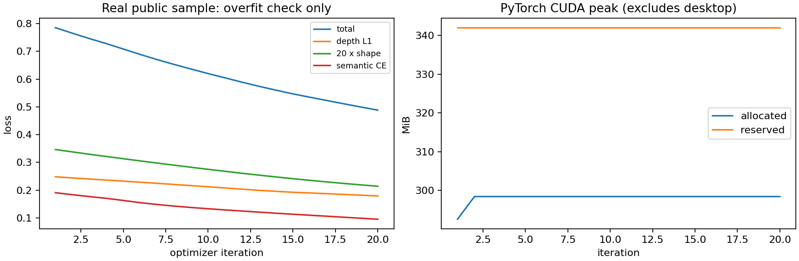

# FYP 实际研究开发报告

项目：Exploring Localization Techniques for Indoor Robotics。记录日期：2026-10-25，Asia/Shanghai。

## 当前结论

已经建立能运行的 RGB + 固定语义地图 → 官方深度/语义射线网络 → 地图匹配 → `(x,y,theta)` 与候选得分的原型，完成32图的工程评价和20次冻结主干优化器更新。**尚未复现出可核验的论文标准Baseline；当前预训练coarse定位表现较差，系统还不能用于可靠机器人定位。** 不将论文性能或同图过拟合结果当成泛化成绩。

## 实际完成

- 下载并审计SemRayLoc、F3Loc、UnLoc官方仓库，记录commit；阅读SemRayLoc及CVPR2026原论文方法。详细技术核查见[研究笔记](RESEARCH_NOTES_zh.md)。
- 取得官方ZInD两个预训练checkpoint（共623,774,124 bytes），通过ZIP CRC、SHA256记录与state_dict严格加载。来源仅为SemRayLoc README给出的Google Drive。没有下载完整数据集。
- 使用[ZInD官方公开住宅示例](https://github.com/zillow/zind/tree/main/sample_tour)，实际准备8个全景位置×4个方向=32张RGB，640×360；语义图1817×1164px，0.01m/px；地图候选网格0.1m、36朝向。每图保存来源、GT位姿、40个轴向结构深度与40个语义类别。
- 复用官方ResNet50网络、depth distribution expectation、40→9射线采样、coarse定位和官方Recall定义。修复GPU数量、配置字典、参数签名、语义匹配分支与ZInD loader中的明确错误。补丁见[official_fixes.patch](official_fixes.patch)。
- 保存所有候选分数与GT/预测可视化；推理入口也实际通过了不提供GT/监督标签的真实RGB查询测试，相关误差字段输出null，无需机器人提供真值。
- 完成已知矩形遮挡消融、mask加权与soft JSD扩展；轻量torchvision LR-ASPP人物分割也已下载并运行，当前空房间样例person比例为0。
- 生成本机实时训练记录页：[打开记录页](http://127.0.0.1:18765/)。Edge连接不可用，该地址仅在运行本地 dashboard 服务的电脑有效。

## 硬件与环境实测

GTX1660 SUPER 6144MiB，compute capability7.5；驱动580.178.04。驱动显示CUDA13.0为支持能力，独立环境实际PyTorch2.5.1+cu121、torchvision0.20.1+cu121，CUDA12.1运行成功。Python3.10.22。i7-10700F，16线程，约16GB物理RAM。启动时/data剩约25GB，依赖、权重和小样本准备后剩约19GB。

现有ROS2 Jazzy、ros_gz_sim/bridge及`/data/FYP_Indoor_Localization/ros2_ws/src/fyp_sim`已检查；没有启动/修改既有仿真工程，没有往原环境安装包。全部新数据、模型、环境和run存于`/data/fyp-semrayloc`，交付目录保留代码、日志、图和指向权重的链接。

当前已验证配置：batch1、640×360、两个官方网络、冻结ResNet主干及其BatchNorm、FP16 autocast、AdamW(lr1e-4)、梯度裁剪1。训练PyTorch峰值allocated **298.41MiB**、reserved **342MiB**；这些数不含桌面进程与部分CUDA上下文开销，也不是全量训练显存需求。

不据此断言原论文batch16全参数训练可在6GB运行。下一步本机先保持batch1与冻结主干，必要时累积梯度；逐步解冻前再测显存。若需高效全参数训练，建议安排12–16GB显存，DINOv2联合模型可优先考虑24GB；这是资源规划建议，未测得这些配置的最低需求。

## 数据与坐标检查

正式研究数据首选Structured3D full，ZInD作真实域验证；当前**实际取得且使用的只有ZInD公开示例**。Structured3D必须先获得[官方授权](https://structured3d-dataset.org/)；没有运行批量下载脚本或使用镜像。ZInD全量数据的Bridge授权/token也尚未取得。

32样本通过字段数量、图像尺寸、类别范围、有限深度、地图尺度和位姿边界检查。真实地图100条随机射线与官方cast_ray对比，最大距离差 **2.29e-07m**，语义全部一致。GT射线oracle位姿为(15.9,2.0,270°)，对应GT约(15.8828,1.9748,270.2463°)，位置差约0.0305m，属于网格离散量级。**这是地图与坐标自检，不是RGB定位精度。** 全零可靠性权重会拒绝输出位姿。

检查过程中发现适配层存在重复导入Enum导致候选mask为空的问题，已经统一导入并加入空mask失败保护，旧无效输出已移出交付结果；atlas缓存现在包含地图与mask内容指纹。官方ZInD径向/轴向监督约定的疑点仍需正式数据和作者协议进一步核对，未掩盖此问题。

## 预训练模型定位实测

**范围：一栋公开住宅、8个全景位置、32个相关视角。预训练是否见过此住宅未知。没有跨建筑独立测试，不提供泛化置信区间。** 官方coarse基线采用确定性语义argmax、无room prior、无refinement；它不是论文完整方法标准评估。

| 条件（每项32图） | 位置中位数 m | 角度中位数 ° | R@0.1m | R@0.5m | R@1m | R@1m,30° |
|---|---:|---:|---:|---:|---:|---:|
| 无干扰，官方coarse | 6.017 | 97.43 | 0.00% | 3.12% | 6.25% | 6.25% |
| 25%矩形遮挡，官方coarse | 7.037 | 86.48 | 0.00% | 0.00% | 0.00% | 0.00% |
| 遮挡 + mask过滤 | 4.844 | 93.54 | 0.00% | 0.00% | 9.38% | 0.00% |
| 遮挡 + mask + soft JSD | 5.309 | 82.83 | 0.00% | 0.00% | 6.25% | 0.00% |

原始逐图结果见[per_image.csv](results/evaluation/per_image.csv)，机器可读汇总见[summary.json](results/evaluation/summary.json)。干净输入的平均网络推理52.65ms，CPU地图匹配116.44ms，合计约169ms/图。计时含本次运行的冷启动样本，不含模型加载、地图atlas预计算、磁盘I/O和绘图；不能把此数字当成ROS端到端延迟。

矩形遮挡后位置中位数变差；mask过滤可降低部分位置误差，但联合Recall仍为0。soft JSD不是所有指标都优于mask alone。现有结果**不支持“鲁棒性已经提升到可用水平”**。这只是已知遮挡位置的控制实验，不能代替真实行人检测、运动或Habitat评价。

第一张查询按原顺序保留失败结果：预训练模型位置误差6.983m、角度误差80.246°。没有从32张中只挑成功图展示。

## 小规模训练实测

20次迭代、**20次优化器更新**，AMP scale固定128，Loss由0.785471降到0.488492。总Loss=深度L1+20×形状损失+ray语义CE；本适配器没有伪造房间标签，故不监督room head。训练计时约4.63s，范围为训练循环，不含模型加载与保存。早期默认GradScaler曾跳过更新，已降低初始scale并重新完成本次20次有效更新；最终CSV明确记录scale与update计数。

权重保存为`$FYP_ROOT/runs/smoke/heads_finetuned.pt`（仅本机保存，未上传），日志见[metrics.csv](results/training/metrics.csv)与[train.log](logs/train.log)。严格state_dict重载成功，并实际执行了微调权重推理。

在**同一张训练图**上，微调后误差为0.1116m、0.2463°；这表明网络和地图匹配链路可对该样本过拟合，**不能视为验证准确率、不能和32图预训练表格作泛化性能比较**。没有独立验证集，validation_loss为空。没有继续开展大规模训练。

## 未完成与真实阻碍

1. 没有Structured3D授权数据，也没有ZInD全量token；单住宅无法诚实划分建筑互斥train/val/test，因此尚未完成标准Baseline复现和独立训练验证。
2. 当前官方coarse推理准确率很低。还需核查ZInD深度约定、官方随机语义采样与argmax差异、room prior与细化步骤，并在标准测试建筑上定位问题。不能仅增加复杂网络掩盖协议/数据问题。
3. CVPR2026原论文已读，但本次未检索到可核验官方代码；没有完整复现DINOv2、双向cross-attention或学习式depth confidence。当前weighted_jsd是明确标注的自主实验扩展。
4. 没有真实人物遮挡/轨迹或Habitat3.0实测。LR-ASPP只在无人物公开图上验证接口成功，不能报告人物检测精度。
5. ROS2节点、连续轨迹、histogram/particle filter、AMCL或LiDAR对照尚未接入。没有在线SLAM建图；系统始终假设地图提前提供。
6. 全量数据所需磁盘不足，不能擅自清理原249GB机器人实验或28GB既有benchmark目录。当前6GB卡已验证轻量微调，尚未验证全参数或DINO训练。

## 下一步按优先级执行

先申请Structured3D并取得少量**不同建筑**的训练/验证/测试样本；不按图像随机拆分。将原始标注、camera_pose、图像顺序、尺度和朝向逐项与官方处理器对齐，尤其核查径向/轴向深度。使用官方checkpoint先跑完整标准评估，记录失败样本、refinement和room prior消融，再冻结主干小规模微调并检查独立验证Loss与定位指标。

Baseline可核验后，才评估人物mask过滤、熵/深度冲突置信度和JSD；使用0/10/25/40/60%受控遮挡及真实行人分组测试，不在测试集调温度。最后以F3Loc/UnLoc的观测似然接口接入odom和SE(2)滤波，封装ROS2节点，保持原地图固定。

运行命令、数据契约、可选行人mask和训练分区检查见[README](README.md)；论文细节、官方问题与方法复用边界见[研究笔记](RESEARCH_NOTES_zh.md)；版本与权重hash见[来源记录](provenance.json)。
