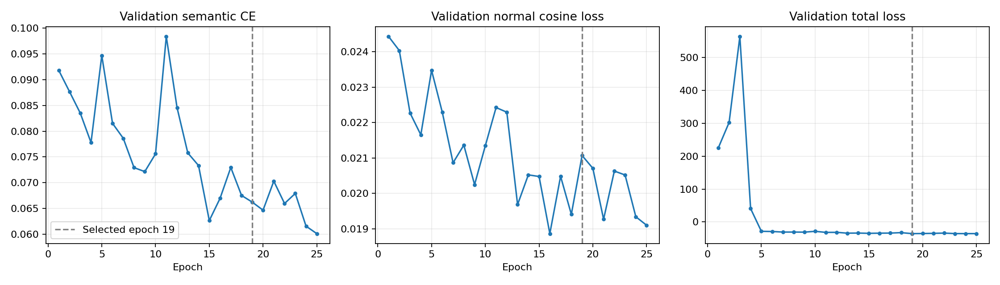
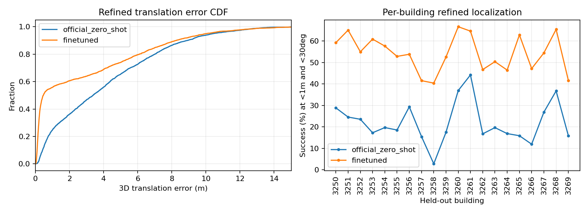

# SPVLoc 100/20/20栋训练与独立建筑定位验收（2026-11-06）

训练、微调模型测试、官方预训练基线测试及独立位姿指标复算均已完成。流水线于北京时间 **2026-11-05 23:31** 正常结束。此次为官方SPVLoc在ProcTHOR上的全参数微调与跨建筑评价，不能称为原Structured3D/ZInD Benchmark的严格数值复现。

## 训练与数据

- 独立建筑140栋：Train 100 / Validation 20 / Test 20，保留官方ProcTHOR划分；同一建筑不跨集合。
- 已验收原生透视图22,400张、RGB全景2,800张；每栋160张原生查询、20个全景光心。
- 训练加载器空图过滤后13,691项，验证2,755项；训练使用官方随机全景裁剪，因此这些不是固定的训练图像曝光总数。
- 测试原始3,200张，经既定官方适配加载器过滤后2,752张（保留86%），每栋126–147张。两模型使用完全相同的2,752个查询，无按误差删除失败样本。成功率分母是合格查询，不是原始3,200张。
- 25/25 epochs，8,575/8,575次优化更新；56,462,316个可训练参数均有更新。FP32，GTX1660 SUPER 6GB，Batch4×梯度累积10，名义批量40；不等价于原生Batch40的BatchNorm。
- 实际计时含轮间验证：49.57小时；累计原版有效样本过滤通过率92.89%。所有CSV中非空训练/验证数值均有限。
- 初次更新实测峰值分配显存3.78GiB、预留4.13GiB；这是首批可行性测量，不能当作整段训练全局峰值。
- 从官方完整S3D权重严格加载后微调；未使用此前已撤回的不合格权重。修正浮点监督保真，原网络/损失/定位算法保持。
- 最佳模型：第19轮、step6517，验证总损失-35.43405。最终第25轮损失-35.39244。按验证总损失选checkpoint，测试集未用于选模或调参。
- 原始training_protocol/progress/evidence文件保留创建时的RUNNING/TRAINING/EVALUATION_PENDING快照文字；最终状态以pipeline_status及独立复算结果为准，未篡改原始证据。

## 验证损失（首轮 → 第25轮）

| 指标 | 首轮 | 最终轮 |
|---|---:|---:|
| 语义交叉熵 | 0.091804 | 0.060103 |
| 法向量余弦损失 | 0.024431 | 0.019101 |
| 平移训练损失（不是定位米制误差） | 0.174053 | 0.109564 |
| 旋转训练损失（不是角度） | 0.062732 | 0.039178 |
| 带学习权重的总损失 | 225.754349 | -35.392445 |

总损失含可学习不确定性权重，可以为负。模型选择使用总验证损失，不能因某个辅助损失更低而事后改选测试模型。



## 正式定位：全体合格查询的3D指标

成功定义：**3D平移 <1m 且完整相对旋转 <30°**；Top-1、固定已知建筑地图。建筑地图身份是本方法既定输入；没有同时在所有140栋中检索建筑。GT从在线输入移除，仅用于监督和离线评价。不是连续VO轨迹ATE。

| 模型 | Refinement | 平移中位数m | 旋转中位数° | 成功率 |
|---|---|---:|---:|---:|
| 官方预训练 | 关闭 | 3.4248 | 84.095 | 21.77% |
| 官方预训练 | 一次 | 3.3764 | 82.643 | 22.06% |
| 自有数据微调 | 关闭 | 1.1577 | 5.516 | 46.84% |
| 自有数据微调 | 一次 | 0.4639 | 4.288 | 54.22% |

精化后：成功率提升 **32.16个百分点**；1,492/2,752个查询成功，官方模型607/2,752。建筑等权宏平均为54.28% vs 21.99%。所有20栋的精化成功率均提高。

## 更严格阈值与失败尾部

附加阈值为本次冻结预测的事后描述统计，不用于改选模型，也不是宣称复现论文同名表格。所有角度均为完整旋转角。

| 指标（精化后） | 官方预训练 | 微调 |
|---|---:|---:|
| <10cm且<5° | 0.18% | 10.17% |
| <50cm且<10° | 11.48% | 50.00% |
| <1m且<30° | 22.06% | 54.22% |
| <5m且<30° | 34.85% | 60.32% |
| 平移均值m | 4.0460 | 2.7922 |
| 平移RMSE m（单帧全局定位） | 5.2482 | 4.5349 |
| 平移P90 m | 8.9214 | 8.2621 |
| 平移P95 m | 10.4330 | 10.0124 |
| 旋转P90 ° | 175.8131 | 165.7048 |

微调后仍有1,260个失败（45.78%）：314个只有平移超阈值，43个只有旋转超阈值，903个两者均超阈值。旋转尾部很大，不能以4.29°中位数声称全面解决方向混淆。尚未逐图确认感知混淆、遮挡或地图采样等具体失败成因。

微调模型的一次refinement：228个失败转成功、25个成功转失败，净增加203个成功（+7.38个百分点）；1,740/2,752个查询平移误差改善。精化并非对每个查询都有效。

## 每栋未见建筑（精化后）

| 建筑 | 查询 | 参考全景 | 官方成功率 | 微调成功率 | 官方平移中位m | 微调平移中位m |
|---|---:|---:|---:|---:|---:|---:|
| 3250 | 135 | 48 | 28.89% | 59.26% | 3.122 | 0.273 |
| 3251 | 126 | 28 | 24.60% | 65.08% | 1.849 | 0.348 |
| 3252 | 140 | 58 | 23.57% | 55.00% | 3.331 | 0.514 |
| 3253 | 133 | 52 | 17.29% | 60.90% | 3.404 | 0.330 |
| 3254 | 137 | 45 | 19.71% | 57.66% | 2.462 | 0.339 |
| 3255 | 140 | 94 | 18.57% | 52.86% | 4.380 | 0.571 |
| 3256 | 143 | 54 | 29.37% | 53.85% | 3.003 | 0.482 |
| 3257 | 142 | 122 | 15.49% | 41.55% | 5.370 | 2.248 |
| 3258 | 141 | 108 | 2.84% | 40.43% | 6.373 | 2.150 |
| 3259 | 137 | 111 | 17.52% | 52.55% | 7.916 | 0.526 |
| 3260 | 138 | 24 | 36.96% | 66.67% | 1.419 | 0.189 |
| 3261 | 147 | 18 | 44.22% | 64.63% | 0.994 | 0.312 |
| 3262 | 137 | 96 | 16.79% | 46.72% | 5.499 | 2.256 |
| 3263 | 127 | 69 | 19.69% | 50.39% | 4.094 | 0.579 |
| 3264 | 142 | 64 | 16.90% | 46.48% | 3.783 | 2.110 |
| 3265 | 132 | 42 | 15.91% | 62.88% | 2.815 | 0.393 |
| 3266 | 142 | 111 | 11.97% | 47.18% | 6.122 | 1.148 |
| 3267 | 145 | 52 | 26.90% | 54.48% | 2.843 | 0.403 |
| 3268 | 136 | 18 | 36.76% | 65.44% | 1.353 | 0.211 |
| 3269 | 132 | 96 | 15.91% | 41.67% | 4.742 | 2.903 |



## 耗时与证据

- 微调单查询平均0.263s，中位0.233s，P95 0.436s；官方平均0.263s。包含初始定位、一次refinement、参考特征重复编码及GPU同步；不含场景地图预处理和模型加载。不是论文预编码缓存配置的公平速度对照。
- 对两模型每个保存位姿逐条独立复算平移及旋转误差，核对重复查询、查询数、20栋覆盖、模型汇总一致性；全部通过。2,752个查询×2模型×2阶段=11,008组位姿误差。
- 发现原始eval记录reference_count误取禁用深度输入的占位张量长度1；实际semantic参考和采样位置都是每栋18–122个。报告从可信本地缓存复核真实数量，per_query_metrics.csv记录修正值。原始记录保留，未来日志字段已修正；不影响推理与旧结果。
- `per_query_metrics.csv`包含每模型/每阶段/每查询的误差、成功标志、计时、实际参考数；`per_building_metrics.csv`包含80组模型/阶段/建筑汇总；`validation_epochs.csv`为25轮验证统计；`training_metrics.csv`为完整原始日志。

## 能支持与尚不能支持的结论

此次证明：官方方法用自有多建筑数据实际更新参数后，在未见ProcTHOR建筑上明显优于官方权重零样本。仍不足以称为可靠机器人定位系统：成功率约54%，误差长尾明显。

尚无纯几何/去语义/去辅助头等受控结果，因此不能把迁移收益全部归因于语义。尚未完成Top-3、论文全部FoV/roll/pitch条件与主要消融；固定测试90°、相机高度近固定；训练8,575步低于论文约42,000步。ProcTHOR不等于真实ZInD，也未进行ZInD训练/定位。详见[论文实现审计](../semantic_training_20261103/PAPER_IMPLEMENTATION_AUDIT_20261104_zh.md)。本次没有用测试结果调整训练条件，也没有重训。

## 复算入口

```bash
/data/fyp_3d/envs/semantic_loc/bin/python research3d/semantic_localization/summarize_completed_training.py \
  --run /data/fyp_3d/runs/semantic_localization_20261103/spvloc_100_20_20_float_targets_v2 \
  --output results/semantic_training_20261106 \
  --cache /data/fyp_3d/datasets/procthor_spvloc/pickle_test_v4_paper_pano
```

模型和原始预测证据通过同仓库Release提供，原始数据集不上传。发布模型只含原始state_dict，不含Adam状态，供原包装器严格加载定位；完整训练checkpoint保留本机。源权重、数据与原方法的许可仍适用。
